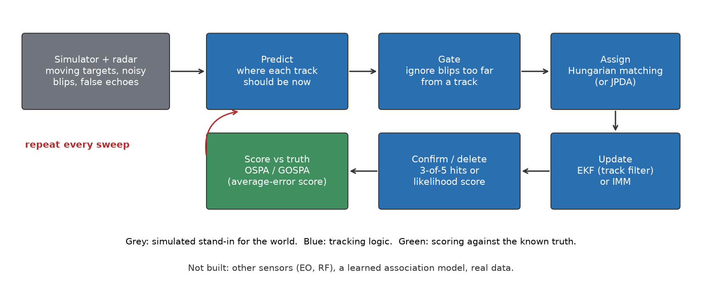
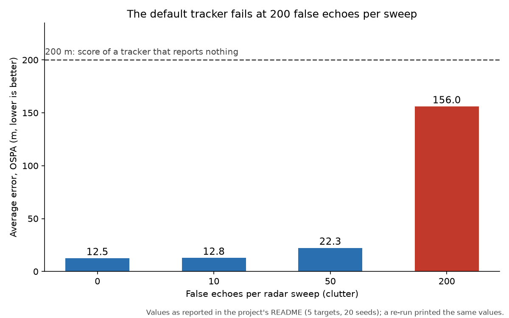
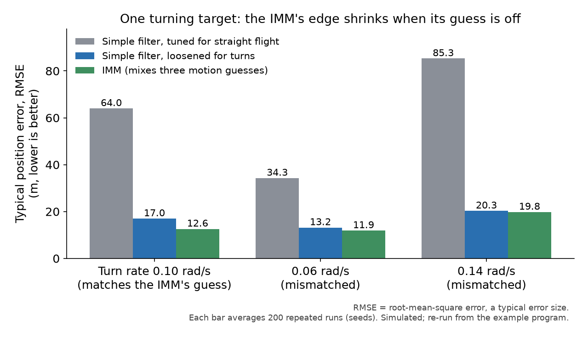
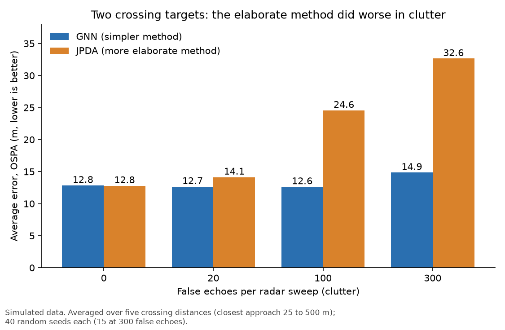

# FuseTrack

*A simulator and a set of tracking programs, written in Rust, that follow several moving objects from noisy radar readings, plus a series of measured experiments that include one result that did not go as hoped.*

Status: version 0.4, in progress, last changed 23 October 2026. Code: https://github.com/PCSchmidt/fusetrack (public, MIT licence, a permissive open-source licence). Everything runs on simulated data; no real sensor has been used.

Imagine a radar screen showing a few dozen blips (dots, each one a detection). The radar sweeps round once a second or so, and each full rotation is a sweep. Some blips are aircraft, some are false echoes (random blips from noise, which the README calls clutter), and every blip is slightly off from where the object really is. A tracking system has to decide which blips belong to the same object from one sweep to the next, ignore the false ones, and say where each object is heading. FuseTrack is my attempt to build that machinery from the ground up and to measure how well each piece works. The README (the front-page text file of a repository) frames it as a start toward counter-UAS (counter-unmanned aircraft systems, meaning defensive systems that detect and follow small drones): tracking only, simulation only, with no weapons or targeting functions.

The results are mixed.

- **A failure and a fix.** A tracker that confirms a new track after "three hits in five sweeps" breaks down at 200 false echoes per sweep, and a likelihood-based rule (a score that rewards blips a real target would plausibly produce) fixes that. The fix was tuned on the same scenarios it is scored on, and it needs to be told how often targets are detected and how dense the false echoes are; a real system would have to estimate both.
- **A helper that depends on a guess.** A filter that mixes several motion guesses (an IMM, described below) beats a plain filter on turning targets, though less when its guess about the turn rate is wrong.
- **A negative result.** A more elaborate way of matching blips to objects (JPDA, described below) did not beat the simpler method in any scenario I tried, and was worse in clutter.

What the numbers mean: the tracking error is scored in metres. A good run scores about 12 to 13 metres, close to the radar's own measurement error (about 15 metres in range). A tracker that reports nothing scores 200. So 156 m under heavy clutter is close to useless, and 12.6 m against 17 m on a turning target is a real but modest gain.

The main caveat: the simulator generates its targets from the same motion rules the filters assume, which is the easy case. The numbers show how the methods compare with each other, not how they would do on real radar. AI coding agents wrote almost all of the code, and I directed the scope, plan, architecture and preferences.

Two more facts about the setup. There is no machine-learning model in this project (a model being software that learned patterns from examples); the README lists a learned association model as a planned later step, and that part does not exist. And the tracking programs follow fixed rules, so the same input gives the same output; the randomness comes from the simulator, which uses a "seed" (a starting number that makes the same random sequence come out every time) so each experiment can be repeated exactly. Results are averages over many seeded runs, so they carry some chance variation.

Terms used in the picture and tables below, in plain words:

- **EKF** (Extended Kalman Filter): the estimator kept for each track, described in the methods chapter.
- **Pd**: the probability of detection, the chance the radar detects a target on a given sweep (Pd 0.9 means 90%).
- **Gating**: ignoring any blip too far from where a track is predicted to be.
- **Hungarian matching**: a standard method for pairing blips with tracks one-to-one so the overall match is as good as possible.
- **OSPA** and its close relative **GOSPA**: error scores for a set of tracks against the true positions, in metres; lower is better. In OSPA, each missing or extra track is charged a fixed 200 metres (GOSPA charges half that for each unmatched track on either side, and the two can differ by a few metres).
- **RMSE** (root-mean-square error): a typical size of the position error, in metres.
- **Seeds**: repeat runs with different random draws, so "20 seeds" means 20 repeat runs.



If you have ten minutes, read this opening, then the chapters on how it works, the results, and the one for recruiters and interviewers.

## What problem this solves

Fielded systems that watch for small drones combine reports from several kinds of sensor: radar, cameras (EO/IR, electro-optical and infrared) and radio-frequency (RF) detectors. Each report is noisy and arrives at its own time. The README names the hard parts: measurements that relate to position in a curved, nonlinear way, targets that turn or speed up, false echoes, and the question of which measurement belongs to which target. This project builds that stack myself rather than calling a ready-made library, and measures it.

A concrete case: two targets fly toward each other and cross. For a few sweeps their blips are close together, and the tracker must decide which blip continues which path. If it swaps them, the track picture says target A is now flying along target B's path. This "identity switch" is one of the things the project counts; fewer is better.

The stated goal is a measured result at the end of every milestone, not just code. The README says it is part of a portfolio index, physical-ai-portfolio. Today only the radar half of the original idea exists. Camera and RF sensors, a learned association model, and Cursor-on-Target output (a text format that mapping software uses to show positions) are listed as planned.

The scope is firm: simulation only, defensive tracking, public methods and synthetic data, nothing weapon-related.

In short, the project exists to build the standard tracking toolkit from scratch and measure when each piece helps and when it does not.

## What it does today

I will follow one toy example through the main program. Suppose two targets are flying and the radar sweeps every second. On each sweep it reports, for each object it detects, a range (distance) and a bearing (angle), each with a little random error. Some sweeps miss a target, and some false echoes appear scattered over the radar's 15 kilometre disc. The list of blips arrives shuffled and unlabelled.

The tracker then works through each sweep in the same order. It predicts where each existing track should be by now. It then gates the blips: it ignores any blip too far from a track's prediction, using a statistical test of whether the blip is farther than noise alone would usually produce (a chi-square test). It then assigns blips to tracks one-to-one so that the overall match is as good as possible. Each matched track updates its estimate. A blip with no track starts a "tentative" track, which becomes a "confirmed" track only after enough evidence, and a confirmed track that goes quiet is kept for five missed sweeps and deleted on the sixth. Finally the evaluation code compares the confirmed tracks against the known truth, which a simulator has and a real radar never would.

The comparison is a lifeguard watching a crowded pool: remembering where each swimmer was a moment ago, expecting them to keep moving the same way, and ignoring splashes too far from anyone. It breaks down because the lifeguard sees directly, while the tracker only sees noisy numbers.

The user is a person running one of the eleven example programs from the command line and reading the printed table.

In short, it takes shuffled noisy blips from a simulated radar and turns them into labelled tracks, then scores them against the truth.

## How it works: parts, data and tools

The code is about 2,900 lines of Rust in the source folder, plus about 580 lines of tests and eleven example programs. It has a simulator that makes the targets and the radar blips; a radar model; an EKF for each track; an IMM as an alternative filter; an assignment solver; the tracker that runs the sweep-by-sweep loop; the JPDA alternative to assignment; and the scoring code. The next chapter describes the methods.

The data is simulated. Targets fly at a steady velocity with small random speed-ups, slow-downs and sideways pushes. The radar adds bell-curve (Gaussian) noise of 15 metres in range and about 0.17 degrees in bearing, which is also roughly 15 metres sideways at 5 kilometres. Clutter is a random number of false echoes spread evenly over the disc. Nothing is downloaded and nothing is private.

The tools are few. Rust is a systems programming language. The nalgebra library supplies the matrix arithmetic, and two random-number libraries supply the seeded noise.

The weakest link is the gap between the simulator and the world (the caveat in the opening): a good score shows that the code does what the textbook says, not that the approach copes with real targets, sensors and clutter.

A second limit is cost. Exact JPDA considers every way of matching blips to tracks in a cluster, and the number of ways grows explosively with clutter, so the code caps the count and falls back to a cheaper approximation.

In short, it is a small pure-simulation stack with few dependencies.

## The methods, and why they were chosen

I will explain the six that matter most. Each has a short toy example, labelled as such.

**The Kalman filter family: the EKF.** A Kalman filter is a recipe for combining a prediction with a noisy measurement, weighting each by how much to trust it. It keeps two things: a best guess of the target's position and velocity, and a measure of how uncertain that guess is. Toy example: the filter predicts the target is 5,000 metres away, with an uncertainty of 20 metres, and the radar says 5,030 metres with an uncertainty of 15 metres. The radar is trusted somewhat more, so the updated guess lands about 5,019 metres, closer to the measurement and more certain than either. The extended version (EKF) is needed because a radar reports range and angle, and the relation between those and position is curved, so the filter uses a straight-line approximation at each step. The project uses a constant-velocity motion model, which says "the target keeps going at the speed and direction it had, apart from small random pushes."

The project also checks that the filter is honest about its own uncertainty. If it is, a particular ratio of actual error to claimed uncertainty averages out to a known value: 4 for the position-and-velocity estimate and 2 for the surprise in each new measurement. The README reports 3.89 and 1.97, very close to those targets.

**Matching blips to tracks: the Hungarian algorithm and the GNN tracker.** With several tracks and several blips, someone has to pair them up. The Hungarian algorithm finds the cheapest one-to-one pairing without trying every combination. Here "cost" is how surprising the blip is for that track. Toy example: tracks A and B, blips 1 and 2, with costs A1 = 1, A2 = 9, B1 = 2, B2 = 3. Pairing A with 1 and B with 2 costs 4; the swap costs 11. The method picks the first. This approach, called GNN (Global Nearest Neighbour), always commits to one pairing. The project checks the solver against brute force on random cost tables.

**Deciding when a track is real.** The default rule confirms a track after three hits in five sweeps. That rule works until the clutter is heavy. The README diagnoses what went wrong at 200 false echoes per sweep: the tracker still found all five true targets but also confirmed about eight false tracks per sweep, because every false echo starts a tentative track and a few of them chain together by luck. The alternative is a likelihood score: each hit adds points in proportion to how likely a real target would have produced it compared with clutter, and each miss subtracts. A track is confirmed when the score passes a threshold. The cost is that the score rule must be told how detectable the targets are and how dense the clutter is, and here it is given the simulator's true values.

**Following turns: the IMM.** A target that flies straight and then turns breaks a constant-velocity filter. An IMM (Interacting Multiple Model) runs several filters side by side, each assuming a different motion (here straight flight, a left turn and a right turn at 0.10 radians per second, about 6 degrees per second), and blends their answers according to how well each one has been predicting. A driver who keeps a few possible routes in mind and weights them by how well each fits the traffic is a fair picture; it breaks down because the IMM's candidate routes are fixed in advance, and if the real road is different from every candidate, the blend has nothing good to choose from.

**Matching softly: JPDA.** Instead of committing to one pairing, JPDA (Joint Probabilistic Data Association) gives every plausible pairing a probability and updates each track using a weighted blend of all the nearby blips. Toy example: if a blip is 60% likely to belong to track A and 40% to track B, both tracks move toward it by those proportions. The textbook argument is that this helps when targets are close together and a hard commitment might swap them. It is much costlier, because it considers every consistent combination.

**The scores.** The tracking error is measured with OSPA (Optimal Sub-Pattern Assignment), and GOSPA (Generalised OSPA) is a close relative. Both pair true targets with tracks one-to-one so the total distance is smallest, cap each pairing's distance at 200 metres, and charge a penalty for every missing or extra track (a full 200 metres in OSPA, half that for each unmatched track in GOSPA).

Toy example: two true targets, three tracks, two matched with errors of 10 and 20 metres and one extra track. The cost is 10 squared plus 20 squared plus 200 squared for the extra one, which is 40,500; divided by three tracks and square-rooted, about 116 metres.

For scale, a good run scores near the radar's own noise, around 12 to 13 metres here, and a do-nothing tracker that reports no tracks scores the full 200 metres on every sweep.

In short, the project implements the classical stack (filter, matcher, confirmation rule, scoring) and is built so that each piece can be compared with an alternative on the same scenarios.

## What it gets right and wrong: the experiments, one by one

The project has no learned model, so the experiments take the place of a model chapter.

**The default tracker against clutter.** With five targets, 100 sweeps and 20 repeat runs (seeds) per setting, and every target detected on every sweep, the default tracker scores about 12.5 metres with no clutter, 22 metres at 50 false echoes per sweep, and about 156 metres at 200, where it confirms about 13 tracks for 5 targets. A tracker doing nothing would score 200, so 156 is close to useless. The cause is false confirmations, not missed targets. The chart below uses the values the README reports, and a re-run of the example program (about two minutes) printed the same twelve-row table.



**Fixing it.** At 200 false echoes and a 0.9 detection chance (Pd 0.9, meaning a target is detected on 90% of sweeps), the likelihood-score rule cuts the error from about 154 metres to 15 metres and false tracks from about 8 to none, at a cost of roughly one extra sweep before a track is confirmed. Stricter counting rules (four of six, five of seven) also work at a 0.9 detection chance but pay for it in delay and missed targets when the detection chance drops to 0.7. The thresholds were tried on the same scenarios the table reports, so the numbers are tuned, not held out. The README says so.

| Rule at 200 false echoes, Pd 0.9 | Mean error (OSPA, metres) | False tracks per sweep | Sweeps to confirm |
| --- | --- | --- | --- |
| 3 of 5 (default) | 154.2 m | 7.99 | 3.4 |
| 5 of 7 | 15.8 m | 0.01 | 5.7 |
| Likelihood score, threshold 12 | 15.1 m | 0.00 | 4.5 |

**Turning targets.** A target that flies straight, turns, flies straight and turns the other way is hard for a plain filter tuned for straight flight: it scores 64 metres of position error (RMSE, a typical error size) when the turn rate matches the IMM's guess. The fair comparison is a plain filter with its process noise loosened (process noise is how much random pushing the filter allows for; more of it lets the filter follow a turn, at the cost of smoother tracking), which scores 17 metres; the IMM scores 12.6, about 26% lower error than that fair baseline. When the real turn rate is 0.06 or 0.14 instead of the 0.10 the IMM assumes (the chart gives units of radians per second; 0.10 is about 6 degrees per second), the edge shrinks to about 10% and under 3%. This is the clearest example in the project of a method's benefit depending on a guess being roughly right. Each bar averages 200 repeat runs (seeds). The version inside the multi-target tracker shows the same pattern: 13.1 metres against 18.5 for the loosened filter when the turn rate matches, but slightly worse (24.0 against 23.0) at 0.14.



**The negative result.** JPDA was supposed to help when targets are close or cross. On crossing targets with no clutter, JPDA matched GNN (12.8 metres each). With clutter it was worse: at 100 false echoes per sweep its error averaged 24.6 metres against 12.6, because it confirms extra false tracks, and at 300 it was 32.6 against 14.9. Each figure averages five crossings whose closest approach ranges from 25 to 500 metres (how near the two targets pass each other), with 40 seeds per crossing (15 at 300 false echoes, where JPDA is slow).

For targets flying side by side at 30 metres apart it made more identity switches than GNN (2.67 per run against 1.23), the opposite of what the method is for.



The project then tried harder scenarios, and JPDA was never better than GNN in any of them:

- shallow-angle crossings (targets sharing a gate for many sweeps): never better in 32 settings, and significantly worse in GOSPA in 23 ("significantly" here means the paired-run 95% interval excludes zero, so chance is an unlikely explanation);
- a radar model that merges close returns into one detection: never better in 36 more settings;
- JPDA combined with the IMM: worse than GNN with the IMM in 38 of 48 settings, better in none.

The documentation limits the claim to this implementation and these two-target scenarios; variants built to stop two tracks collapsing onto one target were not tried.

In short, the project's results are a fixed failure, an improvement that depends on a good guess, and a method that did not help, each written up as it came out.

## Edge cases, testing and safeguards

There are 58 tests in the repository: 39 unit tests inside the source files (each checks one piece in isolation, like testing one gear) and 19 in the tests folder, which run larger scenarios. All 58 pass in a clean copy of the repository. Some check known answers: JPDA probabilities against hand-computed values, the PDA update against the plain filter update when there is one certain measurement, and the matching solver against brute force.

Edge cases the tests or code handle include:

- a measurement outside the gate (it is never assigned);
- a track with no detections (deleted after five misses);
- a cluster with too many possible matchings (it falls back to a cheaper approximation and counts those sweeps);
- the angle wrap-around where a bearing jumps from just under 180 degrees to just over minus 180 (the filter wraps the difference).

What is not covered is anything outside simulation: late or out-of-order measurements, real radar quirks, a crash halfway through a run, or hostile input. The program reads no files and no network, so there is no outside input to attack.

The later JPDA studies compare two trackers on identical simulated scans and report intervals; the earlier tables average over a modest number of seeds with no intervals.

CI (automatic checks on every change) runs on every push to main and on pull requests: a formatting check, the Clippy linter (a tool that flags suspicious code) with warnings treated as failures, and the tests. All 11 runs on file (one per commit) passed, each taking 24 to 35 seconds. CI does not run the experiments, so the result tables in the README are not rechecked automatically.

In short, 58 tests check the building blocks against known answers; the experiments are saved as text files but not re-run by the automatic checks.

## Does it work? The results

The numbers in the previous chapter are the results; the limits on what they support are the opening caveat and the shortcomings chapter below. The JPDA figures match the saved output files kept in the repository. Re-runs of the example programs printed the same values as the README for the turning comparison (single target and inside the tracker) and for the clutter tables (the 12-row sweep and the confirmation-rule comparison), and the later JPDA studies reproduced their saved files exactly. Those README tables have no saved output file, so a reader reproduces them by running the named example commands. The clutter tables take minutes; the heaviest JPDA ones take tens of minutes.

## Could it be put into real use?

No. On the scale of experiment, works on a laptop, deployable and operated, FuseTrack sits at works on a laptop: it builds, passes its tests and runs its experiments, but nothing is hosted, there is no real data and no user other than me is known. It has no stars, no copies made by others and no outside users that I can show. It is a library with example programs, not a service. A real deployment would need real sensor feeds, handling of late and missing data, more sensor types, timing measurements on target hardware and a security review, none of which exists. Two steps would help most: a replay of recorded radar data to see which simulated findings survive, and confidence intervals on the earlier tables with thresholds fixed before testing. As a showcase it rates "possible": it shows measured comparisons and a negative result written up in the repository, but it is not a deployable product.

## Strengths, shortcomings and the work still to do

The roadmap says each milestone ends with a measured result, and the README reports the negative result at length, and the JPDA documentation lists the explanations it has not tested. The filter is checked against statistical consistency targets, and the matching solver against brute force.

Three shortcomings matter most. First, no real radar data: everything is simulated from the filters' own assumptions (see the opening). Second, the clutter fix was tuned on the scenarios it was scored on, and it needs known detection and clutter rates. Third, the main tables carry no confidence intervals. Smaller items: the IMM uses fixed turn rates and its cost is not benchmarked, the IMM is not combined with the likelihood-score rule at heavy clutter, and JPDA works with single-filter tracks in most studies. The README's own list adds: one sensor, targets present for the whole scenario, and clutter that is evenly spread and independent between sweeps.

Of the roadmap, milestones 0.1 to 0.4 are done (0.4 as a measured negative result). Milestones 0.5 to 0.7 are planned: camera and RF bearing-only sensors with timing differences, a learned association model compared against the classical ones, and Cursor-on-Target output with Python bindings. The completeness picture is a finished single-radar classical stack and none of the multi-sensor or learned parts.

## How it was built, and who did what

AI coding agents wrote almost all of the code, as stated at the top. All 11 commits, made between 16 and 23 October 2026, carry an AI co-author credit; the repository has no instruction files or settings folders for agents. Each commit is a milestone, a study or a README update, apart from one that removes a summary file added by mistake. The checks on the agents' work are visible in the repository: tests, consistency statistics, and documentation that records what was and was not tested.

## For recruiters and interviewers

In thirty seconds: I directed AI coding agents to build a radar tracking stack in Rust and measure each piece, with a fix for a clutter failure and a documented negative result for a more elaborate method. It is simulation only, and a learned-association comparison is planned but unbuilt.

| Typical requirement | What the project shows | Strength |
| --- | --- | --- |
| Evaluation and reporting of results | Paired comparisons, a documented negative result, stated limits | Partly |
| Algorithms and numerical code | Filters, assignment, JPDA, tested against known answers | Partly |
| Software practice | 58 passing tests, formatting and lint checks in CI | Partly |
| Deploying and operating | Nothing hosted, no real data | Not shown |

The roles I am aiming at are AI engineer, forward-deployed AI engineer (an engineer placed with a customer) and applied AI or machine-learning engineer. Against those roles, this project gives little direct evidence: it has no machine-learning model and no customer setting. This guide's reading, not a statement from the author, is that the nearest match is applied AI or machine learning, because of the measured comparisons and the planned learned-association study. What not to claim: that it works on real radar, that it handles several sensor types, or that I wrote the code by hand.

Two questions I would expect are how I know the numbers (the JPDA output files are saved, and the tables have named commands that reproduce them) and why JPDA lost (the documentation offers untested explanations: a more permissive score that admits extra false tracks, and tracks collapsing together onto one target).

A five-minute demo: run the single-target example for the filter table, run the turning comparison, show the clutter table and the diagnosis, then the JPDA results file.

## Where to look in the code

```text
fusetrack/
  src/        simulator, radar model, EKF, IMM, matcher, tracker, JPDA, scoring
  tests/      consistency, scenario, IMM and JPDA tests
  examples/   eleven runnable experiments (one per table in the README)
  results/    saved text output of the JPDA studies
  docs/       roadmap, IMM derivation, JPDA write-up
```

The library starts at its top-level file in the source folder; the tracker file holds the main loop. The standard Rust build tools (the toolchain) are all that is needed: `cargo test` runs the tests and `cargo run --release --example single_target` runs the first experiment.
